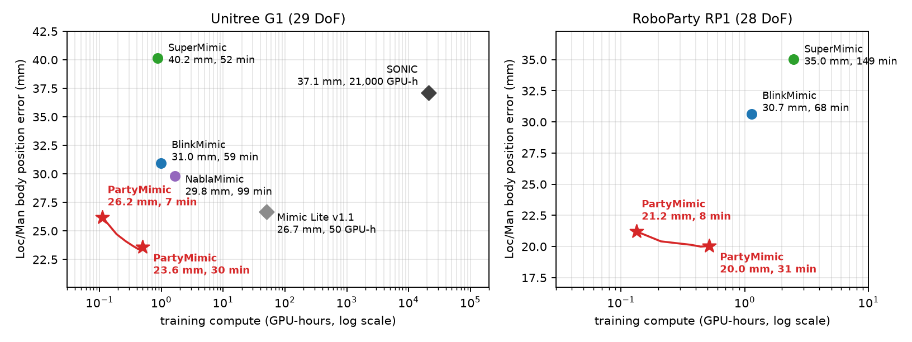
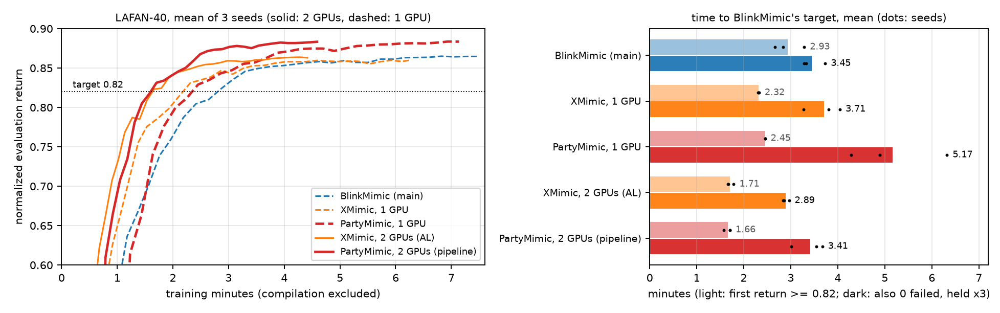

# PartyMimic

**General humanoid motion tracking in minutes on one GPU.** PartyMimic trains one whole-body tracking policy for a
9,173-clip motion library (21 h) on a **single RTX 4090** (22 GB peak):

- **Fast:** 7–30 minutes of training.
- **Precise:** the lowest tracking error of every method we compared, on two humanoids (Unitree G1 and RoboParty RP1).
- **Generalizes:** every result is on held-out motions from another mocap source, and it tracks unseen
  high-dynamic motions zero-shot.

PartyMimic is a model-based learner in the SuperMimic family. It fits an online MLP world model, trains the
policy by backpropagating through 32 imagined steps of that model, and uses a critic beyond the horizon. Its
training recipe is built for generalization and speed. Project page: [roboparty.github.io/PartyMimic](https://roboparty.github.io/PartyMimic/) ([`docs/index.html`](docs/index.html)), with
videos, the recipe ablation and the SuperMimic full-factor ablation.



## GPU memory

Peak memory per card on the full G1 library (300 iterations, `nvidia-smi` once a second). With the default
recipe, one standard 24 GB RTX 4090 is enough (`--ref_enc xattn`: see [Train](#train)):

| Mode | GPU 0 | GPU 1 | it/s |
|---|---:|---:|---:|
| 1 GPU | 22 GB | — | 7.7 |
| 2 GPUs (`--pipeline`) | 14 GB (collection + world model) | 16 GB (policy + critic) | 12.8 |

## Results on held-out motions

Body position error (mm, lower is better) on the held-out MotionDecode splits, scored by the
[sim2real leaderboard](https://egalahad.github.io/sim2real/leaderboard/) sim2sim evaluator. Loc/Man is the mean of
Loc and Man.

| G1 | Training | Loc/Man | Loc | Man | Dance | Ground |
|---|---:|---:|---:|---:|---:|---:|
| SONIC (official) | 21,000 GPU-h | 37.1 | 28.7 | 45.5 | 48.7 | 80.3 |
| Mimic Lite v1.1 (official) | 50 GPU-h | 26.7 | 25.1 | 28.2 | 43.1 | 144.7 |
| SuperMimic | 52 min | 40.2 | 40.5 | 39.8 | 64.3 | 167.8 |
| NablaMimic | 99 min | 29.8 | 32.2 | 27.3 | 46.8 | 110.6 |
| BlinkMimic | 59 min | 31.0 | 31.9 | 30.1 | 53.8 | 98.7 |
| XMimic | 50 min | 30.9 | 31.8 | 30.0 | 53.7 | 101.0 |
| **PartyMimic** (2k iterations) | **6.7 min** | 26.2 | 29.3 | 23.1 | 43.1 | 84.2 |
| **PartyMimic** (12k iterations) | **30 min** | **23.6** | 25.5 | **21.6** | **38.1** | **74.3** |

| RP1 | Training | Loc/Man | Loc | Man | Dance | Ground |
|---|---:|---:|---:|---:|---:|---:|
| SuperMimic | 149 min | 35.0 | 39.9 | 30.2 | 56.4 | 158.4 |
| BlinkMimic | 68 min | 30.7 | 32.2 | 29.1 | 51.7 | 126.0 |
| XMimic | 59 min | 30.6 | 33.4 | 27.9 | 52.8 | 126.7 |
| **PartyMimic** (2k iterations) | **8.0 min** | 21.2 | 24.6 | 17.8 | 39.9 | 115.7 |
| **PartyMimic** (12k iterations) | **31 min** | **20.0** | **23.6** | **16.5** | **35.9** | **103.6** |

<sub>SuperMimic (paper hyperparameters), NablaMimic (official config), BlinkMimic (main preset), XMimic (its defaults,
BlinkMimic's 12k iterations; npz loader and RP1 scene added) and PartyMimic were all trained by us. Each run had one RTX 4090 to itself, and all used the same 9,173 clips (BONES-SEED + LAFAN1,
retargeted per robot). Time is training wall-clock on one GPU. PartyMimic rows are 2-seed means.
Test motions come from a different mocap source; no 1-s window lies within 0.059 rad RMS of the training set.
SONIC and Mimic Lite are official leaderboard entries with different data and hardware. Full protocol and
completion rates are on the [project page](docs/index.html#results).</sub>

**High-dynamic motions, zero-shot** (64 clips none of the methods trained on; % completed / body position error,
PartyMimic 2-seed mean, other methods at the checkpoints in the tables above):

| G1 | Jumps | Martial arts | Twists & kip-ups | Flips |
|---|---:|---:|---:|---:|
| Other methods (range) | 76–100% / 41.9–58.8 mm | 73–87% / 49.7–77.9 mm | 7–36% | 0–11% |
| **PartyMimic** | 94% / **34.0 mm** | 87% / **39.7 mm** | 32% | 6% |

Where the motion can be tracked (jumps, martial arts), PartyMimic is the most accurate on both robots; RP1 has the
same pattern (41.5 / 27.7 mm against 49.3 mm or more). Flips fail for every method, SONIC included. The robot
starts to turn without taking off: its pelvis rises 0.08–0.10 m, against 0.35 m in the reference. Only 7 of the
9,173 training clips are flips. With 105 extra flip, twist-jump and kip-up clips in training, G1 completes 10 of 18
flips instead of 1, without losing held-out Loc/Man accuracy; front tuck somersaults stay unlearned. Videos are on the
[page](docs/index.html#highdyn).

**The PartyMimic recipe**: what matters most, measured by the effect of removing each factor on G1 Loc/Man:

| Factor | Effect when removed |
|---|---|
| Muon for policy and world model | Adam instead: +10.7 mm |
| Narrow tracking-reward kernels (`--std_scale 0.35`) | +6.5 mm |
| 32-step imagination | 16 steps: +5.9 mm |
| Reference-action skip | +5.6 mm |
| Policy EMA | +3.4 mm |
| Value-gradient consistency, Muon on all layers, diversity-balanced resets, self-imitation | 0.5–1.6 mm each; Ground +6–19 mm without balanced resets |

The page explains why each factor matters.

## Speed on LAFAN: against XMimic and BlinkMimic (LAFAN-40)

This comparison is on the LAFAN dataset, not the held-out library. [XMimic](https://github.com/nico-bohlinger/xmimic)'s benchmark, run on our RTX 4090s with its protocol. All runs
train on its 40 LAFAN1 clips (SHA-256 checked) and are scored on the same clips: 4 replicas, every 100 iterations.
Columns give minutes to BlinkMimic's target, as the mean of 3 seeds. Compilation is excluded for every method by
XMimic's `exclude_compile.py` rule; the start-up column adds it back with warm compilation caches.

| Method | GPUs | it/s | Return ≥ 0.82 | + 0 failed, held ×3 | Held, with start-up | Return at 3,500 it |
|---|---:|---:|---:|---:|---:|---:|
| BlinkMimic (main) | 1 | 7.8 | 2.93 | 3.45 | 3.62 | 0.865 |
| XMimic | 1 | 9.3 | 2.32 | 3.71 | 3.96 | 0.860 |
| **PartyMimic** | 1 | 8.2 | 2.45 | 5.17 | 5.57 | **0.883** |
| XMimic (AL) | 2 | 13.2 | 1.71 | **2.89** | **3.17** | 0.863 |
| **PartyMimic** (`--pipeline`) | 2 | 12.7 | **1.66** | 3.41 | 3.82 | **0.883** |



On the 9,173-clip sets XMimic matches BlinkMimic's held-out error in 15% less time (tables above). On LAFAN-40,
PartyMimic reaches return 0.82 in the fewest iterations and ends highest. It is slower to zero failures: one or two
hard training clips keep failing for a while. BlinkMimic and XMimic search for those clips with evaluation probes;
PartyMimic dropped the probes because they did not improve held-out tracking. On the second GPU's x1 PCIe link,
the pipeline overlaps all transfers with compute (details on the [page](docs/index.html#speed)).

## Setup

Linux x86_64, an NVIDIA GPU with a CUDA 12.8 driver, and [uv](https://docs.astral.sh/uv/).

```bash
git clone git@github.com:Roboparty/PartyMimic.git partymimic && cd partymimic
uv sync                    # mjlab, MuJoCo Warp, torch 2.9.0 (CUDA 12.8)
tools/download_data.sh     # G1 description + 40 G1-retargeted LAFAN1 clips -> data/ (enough for a first run)
```

RP1 is not redistributed here. Put its capsule-collision MJCF and meshes (`rp1_28dof_mjlab`) in
`data/rp1_28dof_mjlab/` and its motions in `data/rp1_motions/`, or pass `--motion_dir`.

**Motion data.** `--motion_dir` takes a directory of `.npz` clips, each with `fps` (50), `joint_pos` `[T, J]`,
`body_pos_w` `[T, B, 3]` and `body_quat_w` `[T, B, 4]` (wxyz). The joints and bodies follow the robot's order
(`src/partymimic/<robot>/`), with the pelvis first.
The results above used 10,000 randomly sampled BONES-SEED G1 retargets. Clips with a body more than 3 cm below the
ground or a joint speed above 25 rad/s were removed, leaving 9,133, plus the 40 LAFAN1 clips. For RP1, the same
motions were retargeted to RP1.

## Train

The defaults of `partymimic.train` are the PartyMimic recipe:

```bash
bash scripts/train.sh logs/g1_s0  --robot g1mj --motion_dir <npz clips> --seed 0   # 12k iterations, ~30 min on a 4090
bash scripts/train.sh logs/rp1_s0 --robot rp1  --motion_dir <npz clips> --seed 0
# two GPUs: collection + world model on cuda:0, policy + critic on cuda:1, overlapped (1.6x the iterations per second)
bash scripts/train.sh logs/g1_p0  --robot g1mj --motion_dir <npz clips> --seed 0 --pipeline
```

With `--pipeline`, the policy learns from the previous iteration's data and world model, and the actor collects
with the policy from the previous update. On the 9,173-clip G1 set this trains 12k iterations in 16 min instead of
30 min, at the same Loc/Man error (23.2 vs 23.6 mm, 2 seeds; Ground 78.3 vs 74.3 mm).

**Options.**

- `--ref_enc xattn`: a cross-attention reference encoder. It is more precise on ground motions (Ground 4–8 mm lower,
  Dance 2 mm lower, Loc/Man unchanged; 2 seeds on a larger mixed library) and takes 1.6x the training time on a 4090.
  It needs more than 24 GB. On a 24 GB card, add `--pi_batch 1024`: Ground and high-dynamic errors are then 2–3 mm
  above the full batch, and Loc/Man and Dance are unchanged.
- `--interface sparse5`: the policy is given only the pelvis, head, wrist and ankle poses of the reference, with no
  joint angles (e.g. for teleoperation or video pose). A keypoint-to-joint network is fit to the library before
  training and restores the reference-action skip (`--kp_skip`). An auxiliary joint-angle loss is added
  (`--kp_aux 1.0`). Both are on by default with sparse5. On RP1 (2 seeds) it reaches Loc/Man 21.1 mm and Ground
  100.0 mm, against 19.5 and 94.3 mm with joint references. Export it with `tools/export_deploy_onnx.py` (input
  `ref_kp`).
- `--init <run>/last.pt`: fine-tunes a trained policy on a few clips, e.g. one hard clip before it is deployed. Three
  held-out G1 ground transitions went from 120–415 mm to 24–36 mm in 2k iterations (about 50 s per 250 iterations after
  start-up). It does not help on short, highly dynamic clips.

Checkpoints are written every 2,000 iterations (`ckpt_002000.pt`, ...). On G1, Loc/Man already beats the
previous best at 2,000 iterations. At 8,000 iterations Loc/Man, Dance and Ground are all the best in the comparison.
`uv run python -m partymimic.train -h` lists the remaining options.

## Evaluate, export, visualize

```bash
# sim2real leaderboard protocol (ONNX + deploy YAML, MuJoCo CPU sim2sim on MotionDecode)
SIM2REAL=<checkout of github.com/EGalahad/sim2real> bash scripts/eval.sh logs/g1_s0/ckpt_012000.pt eval/g1_s0 g1
# side-by-side videos of the median clip per split: robot solid, reference ghost, both at global poses
MUJOCO_GL=egl python tools/sim2sim_video.py eval/g1_s0 g1 <robot MJCF> videos --sim2real <sim2real checkout>
# other splits / a chosen clip: --splits <split>:<title>[:<clip stem>] ... --note zero-shot
```

Also included: `tools/export_deploy_onnx.py`, which writes the ONNX and deploy YAML for the sim2real controller
(sim2sim and real robot). `tools/eval_batch.py` and `tools/eval_metrics.py` give fast in-simulator evaluation
on the training clips. `tools/export_onnx.py` and `tools/play_onnx.py` produce a single-motion ONNX in the
BeyondMimic layout.

## Attribution and license

PartyMimic is derived from [BlinkMimic](https://github.com/fuyichen0725/blinkmimic), which builds on
[supermimic_vibed](https://github.com/zita-ch/supermimic_vibed) and
[InstantTrack](https://github.com/Huy-Quang-Dao/instantTrack). All three are MIT-licensed; their notices are in
[THIRD_PARTY_NOTICES.md](THIRD_PARTY_NOTICES.md).
Methods: SuperMimic (Liao et al., arXiv:2610.28480, 2026), SHAC (Xu et al., 2022), BeyondMimic (Liao et al., 2025)
and Muon (Jordan et al., 2024).
Simulation: [mjlab](https://github.com/mujocolab/mjlab) and
[MuJoCo Warp](https://github.com/google-deepmind/mujoco_warp).
Code: MIT ([LICENSE](LICENSE)). Motion data, videos and checkpoints are derived from third-party motion datasets
(LAFAN1: CC BY-NC-ND 4.0; BONES-SEED: its own license). They are not covered by the MIT License.
